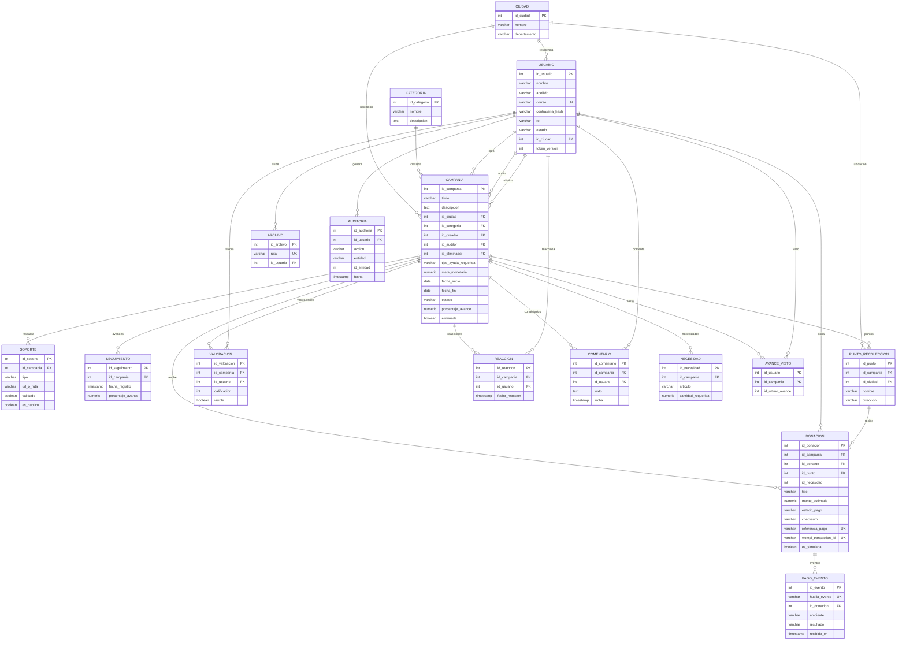

# Diagrama de base de datos — ImpactApp

- **Motor:** PostgreSQL 16 (`impactapp_db`, base `impactapp`).
- **Tablas:** 16 tablas base en el esquema `public`.
- **Generado:** 2026-10-22, por introspección de `information_schema` y `pg_constraint`.
- **Fuente de verdad:** esquema real de Postgres; los modelos SQLAlchemy están en `impactapp_backend/models/`.
- **Nota de nombres:** Postgres usa identificadores entre comillas y con tilde (`"CAMPAÑA"`, `contraseña_hash`). En los diagramas Mermaid se usa `CAMPANIA` y `contrasena_hash` porque esos identificadores no admiten bien UTF-8.

## Diagrama entidad-relación

Solo se muestran las columnas clave; el detalle completo está en el catálogo.



### Relaciones sin FK física

Estas columnas referencian lógicamente a otra tabla, pero no existe restricción en Postgres:

| Columna | Referencia lógica |
|---|---|
| `DONACION.id_necesidad` | `NECESIDAD.id_necesidad` |
| `DONACION.id_validador` | `USUARIO.id_usuario` |
| `DONACION.id_responsable_estado` | `USUARIO.id_usuario` |
| `AVANCE_VISTO.id_ultimo_avance` | `SEGUIMIENTO.id_seguimiento` |
| `AUDITORIA.id_entidad` | Polimórfica según `AUDITORIA.entidad` |

## Catálogo de tablas

Leyenda: **PK** clave primaria · **UK** valor único · **FK** clave foránea.

### `"CIUDAD"`

Catálogo de ciudades y departamentos.

Modelo: `models/city.py`

| Columna | Tipo | Nulo | Clave | Default |
|---|---|---|---|---|
| `id_ciudad` | integer | no | PK | serial |
| `nombre` | varchar(100) | no |  |  |
| `departamento` | varchar(100) | no |  |  |

### `"CATEGORIA"`

Catálogo de categorías de causa social.

Modelo: `models/category.py`

| Columna | Tipo | Nulo | Clave | Default |
|---|---|---|---|---|
| `id_categoria` | integer | no | PK | serial |
| `nombre` | varchar(120) | no |  |  |
| `descripcion` | text | no |  |  |

### `"USUARIO"`

Cuentas de la plataforma (donante, organizador, soporte). Guarda hash bcrypt, estado y versión de token para revocar sesiones JWT.

Modelo: `models/user.py`

| Columna | Tipo | Nulo | Clave | Default |
|---|---|---|---|---|
| `id_usuario` | integer | no | PK | serial |
| `nombre` | varchar(100) | no |  |  |
| `apellido` | varchar(100) | no |  |  |
| `correo` | varchar(150) | no | UK |  |
| `contraseña_hash` | varchar(255) | no |  |  |
| `telefono` | varchar(30) | sí |  |  |
| `biografia` | varchar(500) | sí |  |  |
| `rol` | varchar(11) | no |  |  |
| `foto_perfil` | varchar(255) | sí |  |  |
| `fecha_registro` | timestamp | no |  |  |
| `acepta_tratamiento` | boolean | no |  |  |
| `fecha_aceptacion` | timestamp | sí |  |  |
| `estado` | varchar(9) | no |  |  |
| `id_ciudad` | integer | sí | FK → "CIUDAD"(id_ciudad) |  |
| `version_sesion` | integer | no |  | `0` |
| `fecha_supresion` | timestamp | sí |  |  |
| `token_version` | integer | no |  | `0` |

### `"CAMPAÑA"`

Campañas solidarias. Incluye estado de verificación, auditoría de aprobación/rechazo y eliminación lógica.

Modelo: `models/campaign.py`

| Columna | Tipo | Nulo | Clave | Default |
|---|---|---|---|---|
| `id_campania` | integer | no | PK | serial |
| `titulo` | varchar(200) | no |  |  |
| `descripcion` | text | no |  |  |
| `id_ciudad` | integer | no | FK → "CIUDAD"(id_ciudad) |  |
| `id_categoria` | integer | no | FK → "CATEGORIA"(id_categoria) |  |
| `id_creador` | integer | no | FK → "USUARIO"(id_usuario) |  |
| `tipo_ayuda_requerida` | varchar(12) | no |  |  |
| `meta_monetaria` | numeric(12,2) | no |  |  |
| `fecha_inicio` | date | no |  |  |
| `fecha_fin` | date | no |  |  |
| `estado` | varchar(15) | no |  |  |
| `cuenta_recaudo` | varchar(100) | sí |  |  |
| `nota_revision` | text | sí |  |  |
| `fecha_revision` | timestamp | sí |  |  |
| `id_auditor` | integer | sí | FK → "USUARIO"(id_usuario) |  |
| `porcentaje_avance` | numeric(5,2) | no |  |  |
| `eliminada` | boolean | no |  | `false` |
| `motivo_eliminacion` | text | sí |  |  |
| `fecha_eliminacion` | timestamp | sí |  |  |
| `id_eliminador` | integer | sí |  |  |
| `fecha_verificacion` | timestamp | sí |  |  |

### `"DONACION"`

Donaciones económicas y en especie, con checksum de integridad, estado de pago e idempotencia de Wompi.

Modelo: `models/donation.py`

| Columna | Tipo | Nulo | Clave | Default |
|---|---|---|---|---|
| `id_donacion` | integer | no | PK | serial |
| `id_campania` | integer | no | FK → "CAMPAÑA"(id_campania) |  |
| `id_donante` | integer | no | FK → "USUARIO"(id_usuario) |  |
| `id_punto` | integer | sí | FK → "PUNTO_RECOLECCION"(id_punto) |  |
| `tipo` | varchar(12) | no |  |  |
| `monto_estimado` | numeric(12,2) | no |  |  |
| `descripcion` | text | sí |  |  |
| `fecha_donacion` | timestamp | no |  |  |
| `checksum` | varchar(64) | sí |  |  |
| `estado_pago` | varchar(20) | no |  | `'pendiente'` |
| `referencia_pago` | varchar(255) | sí |  |  |
| `wompi_transaction_id` | varchar(120) | sí |  |  |
| `metodo_pago` | varchar(40) | sí |  |  |
| `fecha_pago` | timestamp | sí |  |  |
| `comprobante_ruta` | varchar(255) | sí |  |  |
| `comprobante_hash` | varchar(64) | sí |  |  |
| `referencia_transferencia` | varchar(120) | sí |  |  |
| `cuenta_destino` | varchar(100) | sí |  |  |
| `nota_validacion` | text | sí |  |  |
| `id_validador` | integer | sí |  |  |
| `fecha_validacion` | timestamp | sí |  |  |
| `id_necesidad` | integer | sí |  |  |
| `cantidad` | numeric(12,2) | sí |  |  |
| `unidad` | varchar(40) | sí |  |  |
| `estado_entrega` | varchar(30) | sí |  |  |
| `fecha_estado` | timestamp | sí |  |  |
| `id_responsable_estado` | integer | sí |  |  |
| `clave_registro` | varchar(100) | sí |  |  |
| `version_integridad` | integer | no |  | `1` |
| `es_simulada` | boolean | no |  | `false` |
| `clave_checkout` | varchar(64) | sí |  |  |

### `"PAGO_EVENTO"`

Eventos de webhook de Wompi deduplicados por huella SHA-256.

Modelo: `models/payment_event.py`

| Columna | Tipo | Nulo | Clave | Default |
|---|---|---|---|---|
| `id_evento` | integer | no | PK | serial |
| `huella_evento` | varchar(64) | no | UK |  |
| `tipo_evento` | varchar(40) | no |  |  |
| `id_donacion` | integer | sí | FK → "DONACION"(id_donacion) |  |
| `referencia` | varchar(255) | sí |  |  |
| `wompi_transaction_id` | varchar(120) | sí |  |  |
| `estado_wompi` | varchar(20) | sí |  |  |
| `monto_en_centavos` | bigint | sí |  |  |
| `moneda` | varchar(3) | sí |  |  |
| `ambiente` | varchar(10) | no |  |  |
| `resultado` | varchar(20) | no |  |  |
| `recibido_en` | timestamp | no |  |  |

### `"SOPORTE"`

Evidencias y documentos que respaldan una campaña.

Modelo: `models/support.py`

| Columna | Tipo | Nulo | Clave | Default |
|---|---|---|---|---|
| `id_soporte` | integer | no | PK | serial |
| `id_campania` | integer | no | FK → "CAMPAÑA"(id_campania) |  |
| `tipo` | varchar(25) | no |  |  |
| `url_o_ruta` | varchar(255) | no |  |  |
| `descripcion` | text | sí |  |  |
| `fecha_carga` | timestamp | no |  |  |
| `validado` | boolean | no |  |  |
| `es_publico` | boolean | no |  | `false` |

### `"SEGUIMIENTO"`

Avances publicados por el organizador con porcentaje de cumplimiento.

Modelo: `models/tracking.py`

| Columna | Tipo | Nulo | Clave | Default |
|---|---|---|---|---|
| `id_seguimiento` | integer | no | PK | serial |
| `id_campania` | integer | no | FK → "CAMPAÑA"(id_campania) |  |
| `fecha_registro` | timestamp | no |  |  |
| `descripcion` | text | no |  |  |
| `porcentaje_avance` | numeric(5,2) | no |  |  |
| `evidencia_url` | varchar(255) | sí |  |  |

### `"PUNTO_RECOLECCION"`

Puntos de acopio asociados a una campaña.

Modelo: `models/collection_point.py`

| Columna | Tipo | Nulo | Clave | Default |
|---|---|---|---|---|
| `id_punto` | integer | no | PK | serial |
| `id_campania` | integer | no | FK → "CAMPAÑA"(id_campania) |  |
| `id_ciudad` | integer | no | FK → "CIUDAD"(id_ciudad) |  |
| `nombre` | varchar(150) | no |  |  |
| `direccion` | varchar(255) | no |  |  |
| `horario` | varchar(150) | no |  |  |
| `contacto` | varchar(100) | no |  |  |

### `"VALORACION"`

Calificaciones de 1 a 5 con comentario opcional.

Modelo: `models/rating.py`

| Columna | Tipo | Nulo | Clave | Default |
|---|---|---|---|---|
| `id_valoracion` | integer | no | PK | serial |
| `id_campania` | integer | no | FK → "CAMPAÑA"(id_campania) |  |
| `id_usuario` | integer | no | FK → "USUARIO"(id_usuario) |  |
| `calificacion` | integer | no |  |  |
| `comentario` | text | sí |  |  |
| `fecha_valoracion` | timestamp | no |  |  |
| `visible` | boolean | no |  |  |

### `"REACCION"`

Reacciones de usuarios a campañas; una por usuario y campaña.

Modelo: `models/reaction.py`

| Columna | Tipo | Nulo | Clave | Default |
|---|---|---|---|---|
| `id_reaccion` | integer | no | PK | serial |
| `id_campania` | integer | no | UK, FK → "CAMPAÑA"(id_campania) |  |
| `id_usuario` | integer | no | UK, FK → "USUARIO"(id_usuario) |  |
| `fecha_reaccion` | timestamp | no |  |  |

### `"ARCHIVO"`

Archivos subidos y su usuario propietario; la ruta es única.

Modelo: `models/file.py`

| Columna | Tipo | Nulo | Clave | Default |
|---|---|---|---|---|
| `id_archivo` | integer | no | PK | serial |
| `ruta` | varchar(255) | no | UK |  |
| `id_usuario` | integer | no | FK → "USUARIO"(id_usuario) |  |

### `"AUDITORIA"`

Bitácora de acciones. Un trigger impide UPDATE, DELETE y TRUNCATE.

Modelo: `models/auditoria.py`

| Columna | Tipo | Nulo | Clave | Default |
|---|---|---|---|---|
| `id_auditoria` | integer | no | PK | serial |
| `id_usuario` | integer | sí | FK → "USUARIO"(id_usuario) |  |
| `accion` | varchar(80) | no |  |  |
| `descripcion` | text | sí |  |  |
| `entidad` | varchar(50) | sí |  |  |
| `id_entidad` | integer | sí |  |  |
| `direccion_ip` | varchar(45) | sí |  |  |
| `fecha` | timestamp | no |  |  |

### `"COMENTARIO"`

Comentarios de usuarios en campañas. **Sin modelo activo** (tabla heredada).

Modelo: —

| Columna | Tipo | Nulo | Clave | Default |
|---|---|---|---|---|
| `id_comentario` | integer | no | PK | serial |
| `id_campania` | integer | no | FK → "CAMPAÑA"(id_campania) |  |
| `id_usuario` | integer | no | FK → "USUARIO"(id_usuario) |  |
| `texto` | text | no |  |  |
| `fecha` | timestamp | no |  |  |

### `"NECESIDAD"`

Necesidades de artículos por campaña. **Sin modelo activo** (tabla heredada).

Modelo: —

| Columna | Tipo | Nulo | Clave | Default |
|---|---|---|---|---|
| `id_necesidad` | integer | no | PK | serial |
| `id_campania` | integer | no | FK → "CAMPAÑA"(id_campania) |  |
| `articulo` | varchar(150) | no |  |  |
| `categoria` | varchar(30) | no |  |  |
| `unidad` | varchar(40) | no |  |  |
| `cantidad_requerida` | numeric(12,2) | no |  |  |

### `"AVANCE_VISTO"`

Último avance visto por usuario en cada campaña. **Sin modelo activo** (tabla heredada).

Modelo: —

| Columna | Tipo | Nulo | Clave | Default |
|---|---|---|---|---|
| `id_usuario` | integer | no | PK, FK → "USUARIO"(id_usuario) |  |
| `id_campania` | integer | no | PK, FK → "CAMPAÑA"(id_campania) |  |
| `id_ultimo_avance` | integer | no |  |  |
## Restricciones e índices

### Uniques

| Tabla | Columnas | Nombre |
|---|---|---|
| `USUARIO` | `correo` | `USUARIO_correo_key` |
| `ARCHIVO` | `ruta` | `ARCHIVO_ruta_key` |
| `PAGO_EVENTO` | `huella_evento` | `uq_pago_evento_huella` |
| `DONACION` | `referencia_pago` | `uq_donacion_referencia_pago` |
| `DONACION` | `wompi_transaction_id` | `uq_donacion_wompi_transaction_id` |
| `DONACION` | `clave_registro` | `donacion_clave_registro` |
| `DONACION` | `clave_checkout` | `uq_donacion_clave_checkout` |
| `REACCION` | `id_campania`, `id_usuario` | `uq_reaccion_campania_usuario` |

### Checks

| Tabla | Restricción | Valores |
|---|---|---|
| `PAGO_EVENTO` | `ck_pago_evento_ambiente` | `test`, `prod` |
| `PAGO_EVENTO` | `ck_pago_evento_resultado` | `aplicado`, `ignorado`, `sin_donacion` |

### Índices no únicos

| Tabla | Índice | Columna |
|---|---|---|
| `PAGO_EVENTO` | `ix_PAGO_EVENTO_wompi_transaction_id` | `wompi_transaction_id` |

### Disparadores

| Tabla | Trigger | Efecto |
|---|---|---|
| `AUDITORIA` | `auditoria_inmutable` | Bloquea `UPDATE`, `DELETE` y `TRUNCATE`; la bitácora es de solo inserción |

## Reglas de negocio embebidas en el esquema

- **Roles de usuario** (`USUARIO.rol`): `donante`, `organizador`, `soporte`.
- **Estado de usuario** (`USUARIO.estado`): `activo`, `bloqueado`, `anulado` (según `services/auth_service.py`).
- **Estado de campaña** (`CAMPAÑA.estado`): `en_verificacion`, `activa`, `pausada`, `finalizada`. En la práctica `pausada` también representa el rechazo de soporte y `eliminada` es una baja lógica independiente.
- **Tipo de ayuda requerida** (`CAMPAÑA.tipo_ayuda_requerida`): `economica`, `alimentos`, `ropa`, `medicamentos`, `mixta`.
- **Tipos de soporte** (`SOPORTE.tipo`): `documento_oficial`, `certificado_institucional`, `foto`, `imagen`, `enlace_medio`.
- **Aprobación de campaña:** exige al menos un `SOPORTE` de tipo `documento_oficial`, `certificado_institucional`, `rut` o `cedula` (`routes/support_panel_routes.py`).
- **Estado de pago** (`DONACION.estado_pago`): `pendiente`, `aprobada`, `rechazada`; mapeado desde Wompi `PENDING`, `APPROVED`, `DECLINED`. Solo `aprobada` suma a la meta.
- **Idempotencia de pagos:** `PAGO_EVENTO.huella_evento` única evita procesar dos veces el mismo webhook; `DONACION.referencia_pago`, `wompi_transaction_id` y `clave_checkout` son únicos.
- **Integridad de donaciones:** `DONACION.checksum` + `version_integridad` + `clave_registro` detectan alteraciones del monto.
- **Revocación de sesiones:** `USUARIO.token_version` se incrementa al rotar contraseña; los JWT con versión distinta se rechazan.
- **Eliminación de cuenta:** anonimiza el usuario y registra `fecha_supresion`; no borra filas por las FKs.

## Notas y deuda de esquema

1. **Tablas heredadas sin modelo activo:** `NECESIDAD`, `COMENTARIO` y `AVANCE_VISTO` existen en Postgres pero ningún archivo de `impactapp_backend/models/` las declara ni las usa el código actual.
2. **Tablas de asignación financiera no creadas:** `models/asignacion_financiera.py` define `ASIGNACION_FINANCIERA` y `EVENTO_ASIGNACION_FINANCIERA`, pero no se importan en `models/__init__.py`, así que `db.create_all()` no las crea (funcionalidad tras el flag `FINANCIAL_ASSIGNMENTS_ENABLED=0`).
3. **Columnas agregadas por `ALTER TABLE` y ausentes en el modelo:** `CAMPAÑA.fecha_verificacion`, `USUARIO.version_sesion`, `USUARIO.fecha_supresion`, `SOPORTE.es_publico`, además de las columnas de Wompi e integridad en `DONACION` y `PAGO_EVENTO`.
4. **Estados de campaña sin Enum nativo:** son `varchar` con validación en la capa de aplicación, no tipos `ENUM` de Postgres.
5. **Sin Alembic:** los cambios de esquema se aplican con `ensure_user_schema()`, `ensure_campaign_schema()` y `ensure_donation_schema()` en `app.py`; por eso el esquema real y los modelos pueden divergir.
6. **Sin `ON DELETE CASCADE`:** las FKs usan el comportamiento por defecto (`NO ACTION`), de ahí la eliminación lógica (`CAMPAÑA.eliminada`) y la anonimización de usuarios.

## Estado de los datos al generar este documento

| Tabla | Filas | Tabla | Filas |
|---|---:|---|---:|
| `CIUDAD` | 10 | `VALORACION` | 0 |
| `CATEGORIA` | 5 | `REACCION` | 0 |
| `USUARIO` | 3 | `COMENTARIO` | 0 |
| `CAMPAÑA` | 9 | `NECESIDAD` | 0 |
| `DONACION` | 1 | `ARCHIVO` | 1 |
| `PAGO_EVENTO` | 0 | `AUDITORIA` | 11 |
| `SOPORTE` | 4 | `AVANCE_VISTO` | 0 |
| `SEGUIMIENTO` | 1 | `PUNTO_RECOLECCION` | 2 |

## Cómo regenerar este diagrama

```bash
# Tablas del esquema public
docker compose exec -T db psql -U impactapp -d impactapp -c \
  "SELECT table_name FROM information_schema.tables
   WHERE table_schema='public' AND table_type='BASE TABLE' ORDER BY table_name;"

# Columnas, tipos y nulos
docker compose exec -T db psql -U impactapp -d impactapp -c \
  "SELECT table_name, column_name, data_type, character_maximum_length, is_nullable
   FROM information_schema.columns WHERE table_schema='public'
   ORDER BY table_name, ordinal_position;"

# PK, unique y FK
docker compose exec -T db psql -U impactapp -d impactapp -c \
  "SELECT conname, conrelid::regclass AS tabla, pg_get_constraintdef(oid)
   FROM pg_constraint WHERE connamespace='public'::regnamespace
   AND contype IN ('p','u','f') ORDER BY 2, 1;"
```

Si el esquema cambia, actualiza el bloque Mermaid y vuelve a ejecutar las consultas del catálogo.
